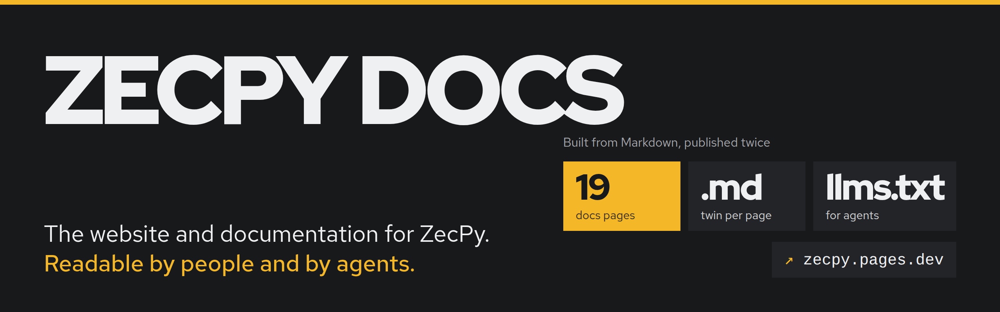

<p align="center">
  <a href="https://zecpy.pages.dev"></a>
</p>

<p align="center">
  <a href="https://zecpy.pages.dev"></a>
  <a href="https://zecpy.pages.dev/llms.txt"></a>
  <a href="#license"></a>
</p>

<p align="center">
  <a href="https://zecpy.pages.dev"><b>Website</b></a> ·
  <a href="https://zecpy.pages.dev/docs/">Docs</a> ·
  <a href="https://zecpy.pages.dev/docs/quickstart">Quick start</a> ·
  <a href="https://zecpy.pages.dev/llms.txt">llms.txt</a> ·
  <a href="https://github.com/mikemoulder/zecpy">ZecPy SDK</a> ·
  <a href="https://zecpy-live.pages.dev">Live demo</a>
</p>

---

**This is the source of [zecpy.pages.dev](https://zecpy.pages.dev), the home of
[ZecPy](https://github.com/mikemoulder/zecpy): private Zcash payments for Python.** It holds
the landing page, the documentation, and a second, plain-text edition of the same docs for
language models and coding agents. Static files, no framework, no analytics.

## What is on the site

| Section | What it covers |
|---|---|
| [**Landing page**](https://zecpy.pages.dev) | The problem, the measured proof (0 identifying requests against 7 and 71), the light server's own request log you can switch between wallets, the API, the public testnet result and the bugs fixed upstream |
| [**Getting started**](https://zecpy.pages.dev/docs/) | Introduction, installation, a quick-start tutorial, and ZecPy Live |
| **Guides** | Accept payments, send and batch payouts, fees and sweeps, cold signing, agent payments, memos and history, the local devnet |
| **Concepts** | The privacy model, the public testnet run, how ZecPy works |
| **Reference** | The API, errors, command-line tools, troubleshooting |
| [**For AI agents**](https://zecpy.pages.dev/docs/agents) | A brief to paste into an agent, and how to give one a wallet safely |

## Readable by agents

Every page exists twice: as HTML for people, and as clean Markdown for models.

| File | What it is |
|---|---|
| [`/llms.txt`](https://zecpy.pages.dev/llms.txt) | An index of the docs in the [llms.txt](https://llmstxt.org) format, with absolute links |
| [`/llms-full.txt`](https://zecpy.pages.dev/llms-full.txt) | Every docs page in one file |
| `/docs/<page>.md` | Each page as Markdown, e.g. [`quickstart.md`](https://zecpy.pages.dev/docs/quickstart.md), linked from the page with `rel="alternate"` |
| [`/AGENTS.md`](https://zecpy.pages.dev/AGENTS.md) | Rules for a coding agent working in a repository that uses ZecPy |

Each docs page also has a **Copy as Markdown** button. `_headers` serves the Markdown and text
files with their real content types, so agents receive text, not a download.

## Layout

```text
content/docs/*.md      the docs, in Markdown with front matter: edit these
build.py               Markdown -> docs/*.html, docs/*.md, llms.txt, llms-full.txt
docs/                  generated: never edit by hand
index.html             the landing page (hand-written)
assets/css, assets/js  site.css and docs.css on one set of tokens; site.js, docs.js
assets/js/requests.js  generated from the SDK's leak-audit logs (see below)
assets/img             screenshots and the recording from ZecPy Live
AGENTS.md, 404.html, _headers
deploy.sh              build and publish to Cloudflare Pages
```

## Write a docs page

Add a Markdown file to `content/docs/` with front matter, then rebuild:

```markdown
---
title: Accept payments
group: Guides
order: 1
description: One sentence. It becomes the page lede, the meta description and the llms.txt entry.
---

Body in Markdown. Code fences with `python` or `bash` are highlighted and get a copy button.
```

`group` is one of `Getting started`, `Guides`, `Concepts`, `Reference`, `AI agents`; `order`
sorts the sidebar. Links between pages use `.html`; the Markdown twins rewrite them to `.md`.

## Build and preview

```bash
uv run --no-project --with markdown python build.py     # writes docs/, llms.txt, llms-full.txt
python -m http.server 8000                              # http://localhost:8000
```

## Deploy

```bash
./deploy.sh
```

It rebuilds, copies only the public files into a temporary folder, and publishes them to the
Cloudflare Pages project `zecpy`. Credentials are read from `~/.zecpy-dev/deploy.env`
(`CLOUDFLARE_API_TOKEN`, `CLOUDFLARE_ACCOUNT_ID`) and never live in this repository.

## Design

One art direction across the landing page and the docs: graphite and the Zcash gold, Red Hat
Display and Red Hat Text, a type-led layout with real interface fragments instead of
illustrations. Pages are checked in a real browser at 1440, 768 and 390 pixels for headline
length, margins, contrast, overflow and motion; the live site passes with no failures.
Motion respects `prefers-reduced-motion`, and every control works from the keyboard.

## Where the content comes from

Nothing on the site is invented.

- **The request log** on the landing page (`assets/js/requests.js`) is generated from the
  leak-audit runs in the SDK, `docs/privacy-report/*.jsonl`.
- **Screenshots and the recording** are captured from ZecPy Live replaying its recorded run.
- **The testnet figures** come from the SDK's recorded run, `docs/testnet-run.md`, with every
  transaction id.
- **Every API detail** in the docs is taken from the SDK's code, `python/zecpy/` and `src/`.

## Part of ZecPy

| Repository | What it is |
|---|---|
| [**zecpy**](https://github.com/mikemoulder/zecpy) | The Python SDK: `pip install zecpy` |
| **zecpy-site** | This repository: the website and docs |
| [**zecpy-demo**](https://github.com/mikemoulder/zecpy-demo) | ZecPy Live, at [zecpy-live.pages.dev](https://zecpy-live.pages.dev) |

Corrections to the docs are welcome as issues or pull requests. Contributions follow the SDK's
[contributing guide](https://github.com/mikemoulder/zecpy/blob/main/CONTRIBUTING.md).

## License

Licensed under either of [Apache License 2.0](LICENSE-APACHE) or [MIT](LICENSE-MIT), at your
option.
