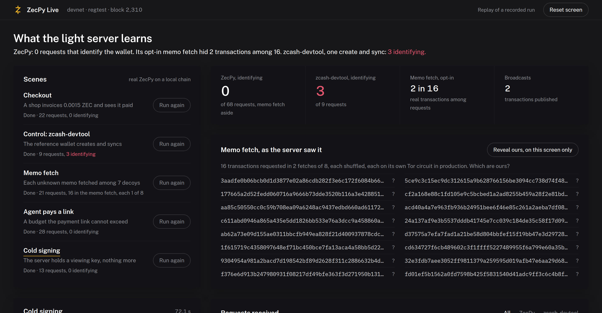

# ZecPy Live demo

> A walkthrough page that runs ZecPy through five scenes on a real chain and shows every request its light server receives.

ZecPy Live is a local web page that runs real ZecPy through five scripted scenes on a
regtest chain. Beside them it shows every request the light server receives, as it
arrives, recorded by two leak-audit proxies. It is the page the demo video is recorded
from.

Source: [github.com/xerodahdev/zecpy-demo](https://github.com/xerodahdev/zecpy-demo)



## The five scenes

| Scene | What runs | What the server learns |
|---|---|---|
| Checkout | A shop wallet issues an invoice, a customer pays it, the payment confirms | Nothing identifying: compact blocks, aligned tree states, one broadcast |
| Control: zcash-devtool | The reference wallet on the same crates creates and syncs, through its own proxy | Its exact birthday and its transparent addresses: 3 identifying requests in the recorded run |
| Memo fetch | Nine payments land in one block; `fetch_memos()` reads the shop's memos | Each real transaction requested among 7 decoys |
| Agent pays a link | An agent reads a ZIP-321 link; `pay(max_zat=100_000)` is refused and `max_zat=200_000` pays | One broadcast; the invoice confirms on the shop's side |
| Cold signing | A watch-only server builds and proves a PCZT; an offline signer inspects and signs it | One broadcast; the server never held a spending key |

All of it is real ZecPy, with real proofs and real blocks. Nothing on the page is mocked:
the replay file is a recorded run of the same scenes.

## Watch the recorded run

You do not need a chain to see it. Clone the demo next to the SDK and serve the replay:

```bash
git clone https://github.com/xerodahdev/zecpy-demo && cd zecpy-demo
source ../zecpy/.venv/bin/activate        # an environment with zecpy and fastapi
uvicorn demo.server:app --port 8077
```

Open `http://127.0.0.1:8077/?replay`. Add `=instant` to show it all at once, and
`&reveal` to mark which memo-fetch transactions were the wallet's own. Those marks come
from the wallet's records; the server received the same requests with no marks.

## Run it live

With the [local devnet](devnet.md) up, the page runs every scene for real:

```bash
cd ../zecpy && devnet/up.sh "$(cat ~/.zecpy-dev/wallets/miner.addr)" && cd -
uvicorn demo.server:app --port 8077
```

Open `http://127.0.0.1:8077` and press Run on a scene. "Reset screen" clears the page
between takes. `pytest -q` in the demo repo runs every scene against devnet and checks its
privacy claims.

## Reading it fairly

- **The audit sees request content, not the network path.** The proxies sit on loopback,
  so these runs use no Tor. In production ZecPy reaches remote servers over Tor.
- **The memo fetch is counted, not hidden.** Every `GetTransaction` is labelled
  identifying, and the page shows the default path and the opt-in memo fetch as separate
  figures.
- **Devnet is a local chain.** No testnet or mainnet funds move.
